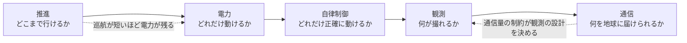

# TSS-550 問題地図

> 550AUのSGL(太陽重力レンズ)ミッションを、5つの課題に分けた全体地図 ・ 改訂 2026-10-25
> 各課題の詳しい中身は「550AU○○フェーズ(入門編)」、数値は [[TSS_定数表]] を参照

---

## 1. 推進

**問題: どうやって550AUまで辿り着くか(Voyager 1の速さ・約17km/sのままだと、約150年かかる)**

| 細分化 | 必要な知識 |
|---|---|
| どの推進方式を選ぶか | 軌道力学、推進工学 |
| 太陽フライバイで加速 | 重力アシストの計算 |
| 太陽帆の設計 | 材料力学、光圧の物理 |
| 燃料と重量のトレードオフ | ロケット方程式(ツィオルコフスキー) |

## 2. 通信

**問題: 550AUから地球へデータを送る(電波でも届くが、十数〜数十bps。損失は約329dB)**

| 細分化 | 必要な知識 |
|---|---|
| 信号強度の計算 | リンクバジェット設計 |
| アンテナの設計 | 電磁気学 |
| レーザー通信の指向精度 | 光学、制御工学 |
| 中継機の配置 | 軌道力学 |
| 遅延込みのプロトコル設計 | 通信工学 |

## 3. 観測・画像

**問題: SGLで何をどう撮るか(焦線は太陽から約547.8AUより先に伸びる)**

| 細分化 | 必要な知識 |
|---|---|
| 太陽をレンズとして使う原理 | 重力レンズ理論、一般相対性理論 |
| 焦線と像の位置の精密な特定 | 天文学、軌道計算 |
| 受け取った信号から画像を復元 | 信号処理、逆問題の数学 |
| どの系外惑星を狙うか | 天文学 |

## 4. 電力

**問題: 150年間動き続ける電源(太陽光は550AUで地球の約30万分の1)**

| 細分化 | 必要な知識 |
|---|---|
| 太陽光パネルの限界距離 | 太陽エネルギー工学 |
| RTG(放射性同位体熱電気転換器)の設計 | 核物理、熱電変換 |
| 消費電力の最小化 | 電気回路設計 |

## 5. 自律制御

**問題: 地球から操作できない(片道約76時間、往復約152時間=約6.4日)**

| 細分化 | 必要な知識 |
|---|---|
| 完全自律の判断システム | AI、制御工学 |
| 異常検知・自己修復 | ソフトウェア工学 |
| 姿勢制御と航法(150年間) | PID制御、慣性航法、カルマンフィルター |

---

## 全体像

**全部つながっている。どれか一つが弱ければ、全部崩れる。**

---

## 改訂メモ(2026-10-25)

| 箇所 | 旧版 | 改訂版 | 理由 |
|---|---|---|---|
| 自律制御 | 往復の記載なし | 往復約152時間(約6.4日) | 550AUの片道は76.2時間(550AU ÷ 光速) |
| 推進 | — | Voyager 1の速さのままだと約150年、を追加 | 550AU ÷ (17km/s ≒ 3.6AU/年) ≒ 153年 |
| 通信 | — | 損失 約329dB を追加 | 定数表の値 |
| 観測 | — | 焦線は約547.8AUより先、を追加 | 定数表の値(最短焦点距離) |
| 全体像 | 表 | Mermaid図(課題どうしの依存を追加) | 今風の書式 |
